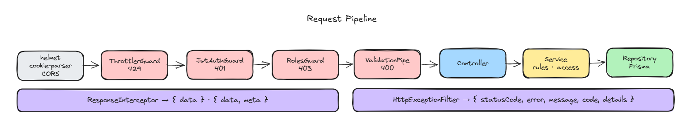
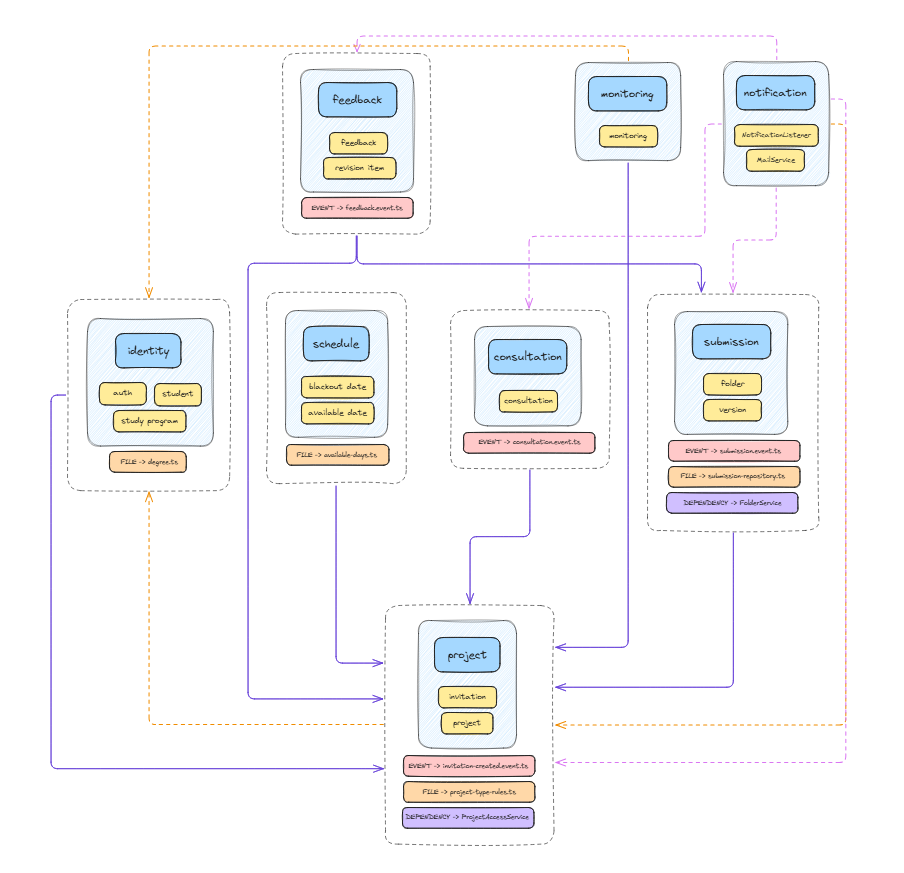
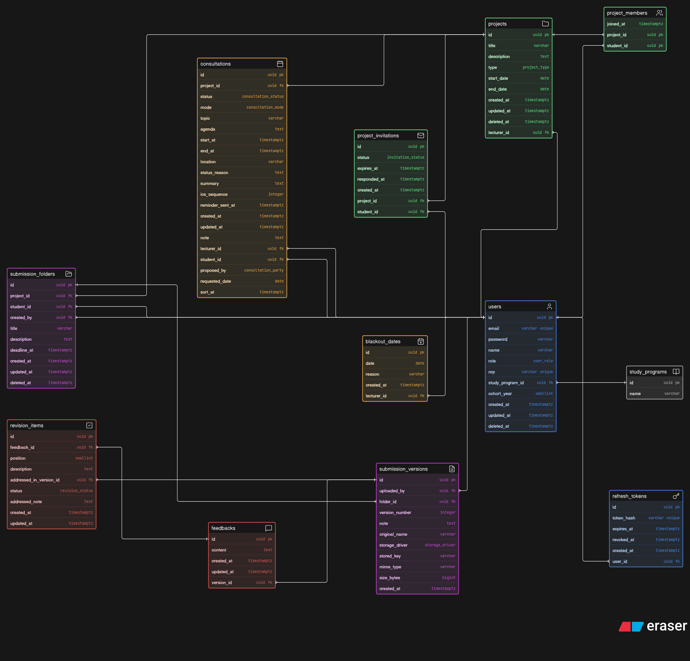

# @konsulin/api

NestJS 11 REST API for Konsulin: supervision projects, consultation scheduling, draft submissions,
feedback with revision checklists, lecturer monitoring and email notifications.

- Base URL `/api/v1`, Swagger UI at `/api/docs`, health check `GET /api/v1/health`
- Module docs (business rules and per-endpoint flows): [`docs/modules/`](../../docs/modules)
- Database (ERD, constraints, migrations): [Database](#database) below

## Getting started

```bash
# 1. dependencies (also runs prisma generate)
pnpm install

# 2. a local Postgres for development and tests
docker run -d --name konsulin-test-db -p 5432:5432 \
  -e POSTGRES_PASSWORD=postgres -e POSTGRES_DB=konsulin_test postgres:16-alpine
docker exec konsulin-test-db createdb -U postgres konsulin

# 3. environment
cp apps/api/.env.example apps/api/.env      # then set JWT_ACCESS_SECRET (≥ 32 chars)
#    SMTP_USER / SMTP_PASS (a Gmail App Password) to really send emails; without them emails are only logged
#    FRONTEND_ORIGIN = the web app's address (CORS and the buttons in every email); restart the API after changes

# 4. schema and master data (from apps/api)
pnpm db:deploy
pnpm db:seed                                 # the 5 study programs

# 5. run (from the repo root)
pnpm dev:api                                 # http://localhost:3000/api/v1
```

### Lecturer accounts

There is no lecturer sign-up: create the account in the database. Hash the password with the same library the API uses
(run from `apps/api`; `read -s` keeps it out of the shell history):

```bash
read -rsp "Password: " P; echo
P="$P" node -e "require('argon2').hash(process.env.P).then(console.log)"; unset P
```

```sql
INSERT INTO users (email, password, name, role, updated_at)
VALUES ('dosen@its.ac.id', '<argon2 hash>', 'Dr. Nama Dosen', 'lecturer', now());
```

Use a lowercase email (login normalises it). Lecturers have no NRP, study program or cohort.

### Scripts

| Where      | Command             | What it does                                      |
| ---------- | ------------------- | ------------------------------------------------- |
| repo root  | `pnpm dev:api`      | start in watch mode                               |
| repo root  | `pnpm test:api`     | unit tests (`src/**/*.spec.ts`)                   |
| repo root  | `pnpm test:api:e2e` | e2e tests (`test/*.e2e-spec.ts`), one at a time   |
| repo root  | `pnpm test:api:cov` | unit + e2e with coverage                          |
| repo root  | `pnpm lint:api`     | ESLint with `--fix`                               |
| `apps/api` | `pnpm db:migrate`   | `prisma migrate dev` (local database only)        |
| `apps/api` | `pnpm db:deploy`    | `prisma migrate deploy` (Supabase, test database) |
| `apps/api` | `pnpm db:seed`      | seed study programs                               |
| `apps/api` | `pnpm db:studio`    | Prisma Studio                                     |

## Architecture

A modular monolith. Each feature is a Nest module; modules talk through exported services (access checks) and domain events (emails). The frontend (`apps/web`) only talks to this REST API.

```
apps/api/
├─ prisma/                  schema, migrations, seed (see Database below)
├─ src/
│  ├─ main.ts, setup-app.ts global prefix, helmet, cookies, CORS, ValidationPipe, filter, interceptor, Swagger
│  ├─ app.module.ts         config, throttler, event emitter, cron, JWT, global guards, modules
│  ├─ config/               env schema (zod)
│  ├─ prisma/               PrismaService (pg adapter), lockLecturer, escapeLike/containsText
│  ├─ generated/prisma/     generated Prisma client (do not edit)
│  ├─ health/               GET /health
│  ├─ shared/
│  │  ├─ auth/              JwtAuthGuard, RolesGuard, @Public, @Roles, @CurrentUser
│  │  ├─ http/              ResponseInterceptor, HttpExceptionFilter + error helpers, pagination, validators, transforms
│  │  ├─ time/              WIB date helpers
│  │  └─ consultation/      cancellation helper + consultation.cancelled event (used by 3 modules)
│  └─ modules/
│     ├─ identity/          auth, students search, study programs        → docs/modules/identity.md
│     ├─ project/           projects, members, invitations, access       → docs/modules/project.md
│     ├─ schedule/          blackout dates, available days               → docs/modules/schedule.md
│     ├─ consultation/      consultations, negotiation, logbook          → docs/modules/consultation.md
│     ├─ submission/        folders, versions, uploads, downloads        → docs/modules/submission.md
│     ├─ feedback/          feedback, revision items                     → docs/modules/feedback.md
│     ├─ monitoring/        lecturer's student overview (read only)      → docs/modules/monitoring.md
│     └─ notification/      emails E1–E11, H-1 reminder cron             → docs/modules/notification.md
└─ test/                    e2e specs, setup-env, utils (app factory, fixtures)
```

### Module layout

Every module is flat and layered:

| File                    | Responsibility                                                                                 |
| ----------------------- | ---------------------------------------------------------------------------------------------- |
| `*.controller.ts`       | routes, `@Roles`, param parsing (`ParseUUIDPipe`), status codes                                |
| `dto/*.dto.ts`          | request validation with `class-validator` (also feeds Swagger)                                 |
| `dto/*-response.dto.ts` | response shapes for Swagger; mappers and services return them, so `tsc` keeps the docs in sync |
| `*.service.ts`          | use cases: access checks, business rules, events, mapping rows to responses                    |
| `*.repository.ts`       | the only place that touches Prisma: queries, transactions, locks                               |
| pure rule files         | e.g. `consultation-state.ts`, `revision-state.ts`, `deadline.ts`, with unit tests              |
| `*-events.ts`           | event names and payload classes                                                                |

### Request pipeline



### Module Dependency



### Response and error format

```json
{ "data": { "id": "…" } }
{ "data": [], "meta": { "page": 1, "limit": 10, "total": 42, "totalPages": 5 } }
{ "statusCode": 409, "error": "Conflict", "message": "Jadwal bentrok dengan bimbingan lain", "code": "CONSULTATION_OVERLAP" }
```

### Access policy

- **Roles** (`@Roles`) decide who may call an endpoint at all → 403.
- **Ownership** decides what they can reach. `ProjectAccessService` returns the project only if the caller is its
  lecturer or a current member with an active account; folders, versions, feedback and revision items follow
  `FolderService.canRead` (track privacy on `individual` projects).
- Anything the caller cannot see is **404**, never 403, so the API does not reveal that it exists. 403 is for a visible
  resource the caller may not change (wrong role, not the folder creator, a student-only field).

### Events

Services emit after the database work succeeds; `NotificationListener` handles them asynchronously, after the response.
A failing listener is logged and never affects the request.

| Event                                                  | Emitted by                                                                   | Email      |
| ------------------------------------------------------ | ---------------------------------------------------------------------------- | ---------- |
| `invitation.created`                                   | project                                                                      | E1         |
| `consultation.requested` … `.rescheduled`, `.proposed` | consultation                                                                 | E2–E6, E11 |
| `consultation.cancelled`                               | consultation, schedule (blackout), project (member removed, project deleted) | E7         |
| `submission.uploaded`                                  | submission                                                                   | E9         |
| `feedback.created`                                     | feedback                                                                     | E10        |
| cron `0 8 * * *` Asia/Jakarta                          | notification                                                                 | E8         |

### Time

- The app works in WIB (`Asia/Jakarta`); the database stores `timestamptz` in UTC.
- Calendar dates (requested dates, blackout dates, project dates) are `YYYY-MM-DD` WIB strings in the API and `date`
  columns in the database; compare them as strings (`shared/time/time.ts`).
- Date-times in requests are ISO 8601 with an offset (`IsDateTime`).

### Uploads

`multer` writes the file to `UPLOAD_TMP_DIR` only after the access guard passed; the service checks extension and magic
bytes, stores the file under `projects/{projectId}/folders/{folderId}/{uuid}.{ext}` with the active driver (`local`:
`UPLOAD_DIR` on disk; `r2`: the private R2 bucket), and an interceptor always removes the temp file. Each version records
its driver, so downloads and deletes use the driver the file was stored with, and switching `STORAGE_DRIVER` only
affects new uploads. Downloads are streamed through the API with the same access rules for both drivers. Details in
[`docs/modules/submission.md`](../../docs/modules/submission.md).

## Database



12 tables (11 + `study_programs` as master data). The logbook has no table: it is `consultations` with status
`completed` and its `summary`. File metadata lives on `submission_versions`, the only place files are used.
