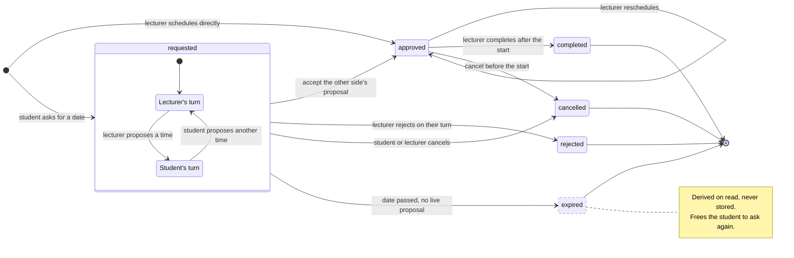

# Consultation module

Supervision meetings between a lecturer and the students of a project: a student
asks for a **date**, both sides negotiate the **time**, and the lecturer closes
the meeting with a summary that becomes the **logbook**.

## Personas

| Persona  | Goal                                                                                       |
| -------- | ------------------------------------------------------------------------------------------ |
| Student  | Ask for a meeting on a free day, agree on a time, and keep a record of what was discussed. |
| Lecturer | Decide when and where meetings happen, avoid double bookings, and log each meeting.        |

## User stories

**US-05 Requesting and scheduling a consultation**

- A student asks for a **date** (one of the lecturer's available days) with topic, agenda, mode (offline/online) and an optional note → email to the lecturer.
- The time is agreed by **negotiation**: the lecturer proposes start–end (and location); the student accepts or counter-proposes; the lecturer accepts, counter-proposes or rejects; this repeats until one side accepts the other's proposal → `approved`. Every proposal is emailed to the other side.
- A proposal may be at any time and on another date than the one asked for, but never on a blacklisted date. Duration 15 minutes–4 hours, start and end on the same WIB date.
- Only the lecturer sets location and mode. A consultation cannot become `approved` without a location.
- A proposal whose start has passed cannot be accepted; whoever has the turn proposes again. A request whose date has passed with no live proposal is **expired** (no email) and no longer blocks a new request.
- The lecturer can reject on their turn (reason required), schedule a meeting directly (`approved` at once), reschedule an `approved` meeting, or cancel. A student can cancel; to move a meeting they cancel and ask again.
- Agreed/scheduled/rescheduled emails carry an `.ics` `REQUEST` + Google Calendar link; cancelling an agreed meeting carries an `.ics` `CANCEL`.
- The day before an agreed meeting, everyone involved gets a reminder (08:00 WIB).

**US-06 Completion and logbook**

- An `approved` consultation whose start has passed can be marked `completed` with a plain-text summary.
- The logbook lists `completed` consultations (date, topic, summary) with student and date-range filters.

The logbook has no table of its own: it is a query over `completed` consultations.
It differs from feedback, which comments on a **draft version**; the logbook records **meetings**.

## Business rules

| ID    | Rule                                                                                                                                                                                                                                                                                               |
| ----- | -------------------------------------------------------------------------------------------------------------------------------------------------------------------------------------------------------------------------------------------------------------------------------------------------- |
| BR-05 | Individual projects: a student only sees their own consultations. Shared projects: a consultation is a **team meeting**, visible to every member (calendar included) and emailed to every active member (see Emails); write actions stay with the requester (403). A former member gets 404.       |
| BR-06 | A requested date is today–60 days ahead (WIB) and not blacklisted. Proposals, direct scheduling and reschedules start 1 hour–60 days from now, not on a blacklisted date, and may be on another date than the one requested.                                                                       |
| BR-07 | `approved` consultations of one lecturer never overlap (exclusion constraint). Unaccepted proposals do not hold the time; overlaps are refused when proposed and when accepted (409).                                                                                                              |
| BR-08 | `requested → approved \| rejected \| cancelled`; `approved → completed \| cancelled`; `rejected`, `completed`, `cancelled` are final. The turn while `requested` follows `proposed_by` (see below). Reschedule only for `approved`; an `approved` meeting cannot be cancelled once started.        |
| BR-09 | `completed` only after `start_at`, by the project lecturer.                                                                                                                                                                                                                                        |
| BR-10 | A blackout range hitting active consultations needs confirmation; with it they are cancelled in the same transaction (see the schedule module).                                                                                                                                                    |
| BR-19 | One live (`requested`, not expired) request per student per project (409).                                                                                                                                                                                                                         |
| BR-20 | 15 min–4 h on one WIB date. Location and mode only from the lecturer; a lecturer proposal needs a location when none is set yet; no `approved` without a location (400 `LOCATION_REQUIRED`).                                                                                                       |
| BR-21 | A request is `expired` on read (not stored, no email) when its date has passed and it has no proposal or its last proposal has passed. Expired requests cannot be acted on (409 `CONSULTATION_EXPIRED`) and do not count for BR-19. A passed proposal cannot be accepted (409 `PROPOSAL_EXPIRED`). |
| BR-22 | Active consultations (`requested` not expired, `approved` not started) are cancelled in the same transaction when the requester is removed from the project or the project is deleted (see the project module).                                                                                    |

## Status flow

`rejected`, `completed`, `cancelled` and `expired` are final. While `requested`, the turn comes from
`proposed_by` and is returned as `turn`: none or the student's proposal → lecturer's turn; the lecturer's proposal → student's turn.

### Transitions

| From                   | To          | Action                  | Who                     | Condition                                                                 | Endpoint                                    |
| ---------------------- | ----------- | ----------------------- | ----------------------- | ------------------------------------------------------------------------- | ------------------------------------------- |
| —                      | `requested` | ask for a date          | student (member)        | date today–60 days, not blacklisted, no live request (BR-19)              | `POST /projects/:id/consultations`          |
| —                      | `approved`  | schedule directly       | lecturer                | valid time, not blacklisted, no overlap                                   | `POST /projects/:id/consultations/schedule` |
| `requested`            | `requested` | propose a time          | party whose turn it is  | valid time, not blacklisted, no overlap; lecturer adds a location if none | `POST /consultations/:id/propose`           |
| `requested`            | `approved`  | accept the proposal     | party whose turn it is  | proposal exists and not passed, location set, no overlap                  | `POST /consultations/:id/accept`            |
| `requested`            | `rejected`  | reject (with reason)    | lecturer, on their turn | not expired                                                               | `POST /consultations/:id/reject`            |
| `requested`            | `cancelled` | cancel                  | requester or lecturer   | not expired                                                               | `POST /consultations/:id/cancel`            |
| `requested`            | `expired`   | — (derived)             | system                  | date passed and no proposal, or the last one passed (BR-21)               | —                                           |
| `approved`             | `approved`  | reschedule              | lecturer                | valid time, not blacklisted, no overlap; `.ics` sequence + 1              | `POST /consultations/:id/reschedule`        |
| `approved`             | `completed` | complete (with summary) | lecturer                | start has passed (BR-09)                                                  | `POST /consultations/:id/complete`          |
| `approved`             | `cancelled` | cancel                  | requester or lecturer   | not started yet                                                           | `POST /consultations/:id/cancel`            |
| `requested`/`approved` | `cancelled` | auto-cancel             | system                  | blackout confirmed (BR-10), requester removed or project deleted (BR-22)  | schedule / project modules                  |

## Access

| Action                                 | Student                      | Lecturer      |
| -------------------------------------- | ---------------------------- | ------------- |
| List / view                            | own; team meetings on shared | own projects  |
| Ask for a date                         | member                       | 403           |
| Propose / accept (on their turn)       | requester                    | project owner |
| Reject, schedule, reschedule, complete | 403                          | project owner |
| Cancel                                 | requester                    | project owner |

Not visible (another lecturer, not a member, individual track of someone else) → **404**. Wrong role → **403**.

## Endpoints

All responses are wrapped as `{ data }` (lists: `{ data, meta }`); errors are `{ statusCode, error, message, code }`.
Every consultation in a response carries `status` (with the derived `expired`), `turn` and `proposedBy`.

### GET /consultations — my calendar

- Lecturer: every consultation of their projects. Student: their own, plus team meetings of shared projects they are still in.
- Filters: `status` (incl. `expired`), `from`/`to` (WIB dates on `sort_at`), `projectId`; sorted by `sort_at`, `order` default `asc`.

### GET /projects/:projectId/consultations

- Project must be visible (404). Individual + student → only their own.
- Filters: `q` (topic), `status`, `studentId`, `from`/`to`; `sort` `createdAt` (default, newest first) or `date`.

### POST /projects/:projectId/consultations — ask for a date (student)

1. Project visible to the student (404).
2. `requestedDate` is today–60 days ahead → else 400 `DATE_NOT_AVAILABLE`.
3. Transaction: **lock the lecturer row** → no live request of this student in the project (409 `CONSULTATION_PENDING_EXISTS`) → date not blacklisted (400 `DATE_NOT_AVAILABLE`) → insert `requested`.
4. Event `consultation.requested` → **E2** to the lecturer.

### POST /projects/:projectId/consultations/schedule — schedule directly (lecturer)

1. Project owned (404); `studentId` is an active member (400 `STUDENT_NOT_MEMBER`).
2. Time valid (BR-06/BR-20) → else 400 `INVALID_TIME_RANGE` / `OUTSIDE_BOOKING_WINDOW`.
3. Transaction: lock lecturer → not blacklisted (400 `DATE_BLACKLISTED`) → no overlap (409 `CONSULTATION_OVERLAP`) → insert `approved`, `proposed_by = lecturer`, `requested_date` = WIB date of the start.
4. Event `consultation.scheduled` → **E5**.

### GET /consultations/:id

Readable per BR-05 (404 otherwise).

### POST /consultations/:id/propose

1. Writable (404/403); a student sending `location`/`mode` → 400 `FIELD_NOT_ALLOWED`.
2. State: `requested`, not expired, actor's turn → else 409 (`INVALID_TRANSITION`, `CONSULTATION_EXPIRED`, `NOT_YOUR_TURN`).
3. Time valid; a lecturer proposal needs a location if none is set (400 `LOCATION_REQUIRED`).
4. Transaction: lock lecturer → not blacklisted → no overlap with `approved` → conditional update on the `proposed_by` it was checked against (409 when someone acted first).
5. Event `consultation.proposed` → **E11** to the other side.

### POST /consultations/:id/accept

1. Writable; only the lecturer may send `location`.
2. State: actor's turn, a proposal exists (409 `NO_PROPOSAL`), not passed (409 `PROPOSAL_EXPIRED`); a location must exist (400 `LOCATION_REQUIRED`).
3. Transaction: lock lecturer → no overlap → conditional update → `approved`. The exclusion constraint is the last guard (409 `CONSULTATION_OVERLAP`).
4. Event `consultation.approved` → **E3** (`.ics` REQUEST) to every participant.

### POST /consultations/:id/reject (lecturer)

State: lecturer's turn → conditional update to `rejected`, reason stored in `status_reason` → **E4**.

### POST /consultations/:id/reschedule (lecturer)

Only `approved`. Time valid → lock → not blacklisted → no overlap (excluding itself) → new time, `ics_sequence + 1`, `reminder_sent_at` cleared → **E6** (`.ics` with the same UID and the new sequence, so calendars move the event instead of adding one).

### POST /consultations/:id/cancel

`requested` not expired, or `approved` not started (409 `CONSULTATION_STARTED` / `CONSULTATION_EXPIRED`). Cancelled with the shared cancellation helper → event `consultation.cancelled` → **E7** (`.ics` CANCEL only if it was `approved`).

### POST /consultations/:id/complete (lecturer)

`approved` and started (409 `CONSULTATION_NOT_STARTED`) → `completed` with `summary`.

### GET /projects/:projectId/logbook

`completed` only, newest first. Filters: `studentId`, `from`/`to`, `q` (topic or summary).

## Emails

The service only emits events; the notification module turns them into emails after the
response is sent. A mail failure is logged and never fails the request.

| Event / trigger            | Email | Recipients                       | Attachment                                  |
| -------------------------- | ----- | -------------------------------- | ------------------------------------------- |
| `consultation.requested`   | E2    | lecturer                         | –                                           |
| `consultation.proposed`    | E11   | participants except the actor    | –                                           |
| `consultation.approved`    | E3    | all participants                 | `.ics` REQUEST + Google link                |
| `consultation.rejected`    | E4    | participants except the lecturer | –                                           |
| `consultation.scheduled`   | E5    | all participants                 | `.ics` REQUEST + Google link                |
| `consultation.rescheduled` | E6    | all participants                 | `.ics` REQUEST (sequence + 1) + Google link |
| `consultation.cancelled`   | E7    | all participants                 | `.ics` CANCEL if it was `approved`          |
| cron 08:00 WIB             | E8    | all participants                 | –                                           |

- **Participants** = the lecturer + the requester, plus every active member on a shared project.
  They are resolved when the email is sent; deleted accounts get nothing. A requester removed
  from the project (BR-22) still gets the E7 for their own meeting.
- **All participants includes the actor**, so every calendar stays in sync with one `.ics` each.
- `consultation.cancelled` is shared with the schedule module (blackout, BR-10) and the project
  module (member removed / project deleted, BR-22), so every cancellation sends the same E7.
- One email per recipient: each gets their own `.ics` (`UID {id}@konsulin`, `ORGANIZER` the
  lecturer, `ATTENDEE` the recipient), so members never see each other's addresses.
- **E8 reminder:** every day at 08:00 WIB, `approved` consultations starting tomorrow (WIB) with
  `reminder_sent_at` empty are claimed in one `UPDATE … RETURNING`, so a rerun sends nothing.
  A reschedule clears `reminder_sent_at`; a meeting approved after 08:00 for the next day gets
  no E8 (its participants just got E3/E5).
- `requested → expired` sends nothing.
