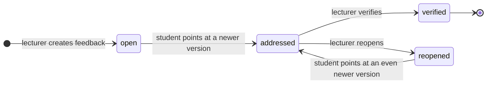

# Feedback module

The lecturer comments on a specific **draft version** and attaches a **revision checklist**.
The student ticks each item off by pointing at the newer version that fixes it, and the
lecturer verifies or reopens it. Feedback is about a document; meeting notes belong to the
logbook (consultation module).

## Personas

| Persona  | Goal                                                                                       |
| -------- | ------------------------------------------------------------------------------------------ |
| Lecturer | Give clear, checkable revision points on a draft and confirm when each one is really done. |
| Student  | Know exactly what to fix, show where each fix is, and see what is still open.              |

## User stories

**US-08 Feedback and revision checklist**

- The lecturer writes feedback (plain text) together with 0..n revision items on one version → email E10.
- The student marks an item `addressed` by pointing at the version that fixes it (a newer version in the same folder).
- The lecturer reviews an addressed item with one endpoint: `verify` or `reopen`.
- After creation only the feedback text can change; items stay as created. Feedback can be deleted only while all
  its items are still `open` (BR-25).
- Revision items can be filtered by status, student and folder.

## Business rules

| ID    | Rule                                                                                                                                                                                                                                                                                                                                                                                    |
| ----- | --------------------------------------------------------------------------------------------------------------------------------------------------------------------------------------------------------------------------------------------------------------------------------------------------------------------------------------------------------------------------------------- |
| BR-05 | Feedback and items follow folder access: a student on an `individual` project only reaches their own track; on `shared` every member does. A removed member gets 404.                                                                                                                                                                                                                   |
| BR-13 | Item status: `open → addressed` (student); `addressed → verified \| reopened` (lecturer); `reopened → addressed` (student). `verified` is final.                                                                                                                                                                                                                                        |
| BR-14 | Addressing needs `versionId` of the same folder (400 `VERSION_NOT_IN_FOLDER`) with a higher number than the feedback's version; for a `reopened` item also higher than the version claimed last time (400 `VERSION_NOT_NEWER`). The last address stays visible while `reopened` and is overwritten by the next one. Any other transition → 409 `INVALID_REVISION_TRANSITION`.           |
| BR-25 | `content` 1–10,000 characters with 0–50 items of 1–1,000 characters (order = `position`), on any version the lecturer can see. PATCH changes `content` only. Delete only while every item is `open` (409 `FEEDBACK_HAS_PROGRESS`). Address: the track owner on `individual`, any member on `shared`. E10 on create only. A removed student's folder can still get feedback and reviews. |

## Revision item status flow

### Transitions

| From                | To          | Action  | Who                                           | Condition                                                                    | Endpoint                           |
| ------------------- | ----------- | ------- | --------------------------------------------- | ---------------------------------------------------------------------------- | ---------------------------------- |
| —                   | `open`      | create  | lecturer (owner)                              | version visible                                                              | `POST /versions/:id/feedbacks`     |
| `open` / `reopened` | `addressed` | address | track owner (`individual`), member (`shared`) | fix in the same folder, newer than the feedback's version and the last claim | `POST /revision-items/:id/address` |
| `addressed`         | `verified`  | verify  | lecturer (owner)                              | –                                                                            | `POST /revision-items/:id/review`  |
| `addressed`         | `reopened`  | reopen  | lecturer (owner)                              | –                                                                            | `POST /revision-items/:id/review`  |

## Access

| Action                                 | Student                                           | Lecturer      |
| -------------------------------------- | ------------------------------------------------- | ------------- |
| List feedback of a version, list items | own track (`individual`), all (`shared`)          | project owner |
| Create / edit / delete feedback        | 403                                               | project owner |
| Address an item                        | track owner (`individual`), any member (`shared`) | 403           |
| Review an item                         | 403                                               | project owner |

Not visible (deleted folder or project, other track, removed member, other lecturer) → **404**. Wrong role → **403**.

## Endpoints

All responses are wrapped as `{ data }` (lists: `{ data, meta }`); errors are `{ statusCode, error, message, code }`.

### GET /versions/:versionId/feedbacks

Readable version (404 `VERSION_NOT_FOUND`). Feedback newest first, each with its items ordered by `position`.

### POST /versions/:versionId/feedbacks (lecturer)

1. Body `{ content, revisionItems?: [{ description }] }` (BR-25 limits) → else 400.
2. Readable version (404); any version of the folder, old ones included.
3. Insert the feedback and its items in one statement (positions 0..n) → 201.
4. Event `feedback.created` → **E10**. A refused request emits nothing.

### PATCH /feedbacks/:feedbackId (lecturer)

Readable feedback (404 `FEEDBACK_NOT_FOUND`) → update `content` only, even after work on the items started → 200.
Sending items → 400.

### DELETE /feedbacks/:feedbackId (lecturer)

1. Readable feedback (404).
2. Transaction: **lock the feedback row** → gone → 404; any item not `open` → 409 `FEEDBACK_HAS_PROGRESS` →
   delete (items cascade) → 200.

### GET /projects/:projectId/revision-items

- Project visible (404). A student on an `individual` project only gets their own track; items in deleted folders are hidden.
- Each item carries its feedback's `version` and `folder`, and `addressedInVersion`.
- Filters: `status`, `studentId`, `folderId`; newest feedback first (`order`), then `position`.

### POST /revision-items/:itemId/address (student)

1. Body `{ versionId, note? }`. Readable item (404 `REVISION_ITEM_NOT_FOUND`).
2. Status `open` or `reopened` → else 409 `INVALID_REVISION_TRANSITION`.
3. `versionId` in the same folder → else 400 `VERSION_NOT_IN_FOLDER`; newer than the feedback's version and the
   last claimed one → else 400 `VERSION_NOT_NEWER`.
4. Transaction: lock the feedback (deleted meanwhile → 404) → conditional update on the status that was checked
   (someone acted first → 409) → `addressed` with `addressed_in_version_id` and `addressed_note` → 200.

### POST /revision-items/:itemId/review (lecturer)

Body `{ decision: "verify" | "reopen" }`. Readable item → status `addressed` (409 otherwise) → conditional update
on `status = addressed` (lost race → 409) → `verified` / `reopened` → 200.

## Emails

| Event / trigger    | Email | Recipients                                                       |
| ------------------ | ----- | ---------------------------------------------------------------- |
| `feedback.created` | E10   | the track owner (`individual`) or every active member (`shared`) |

No email for editing feedback, addressing or reviewing.
