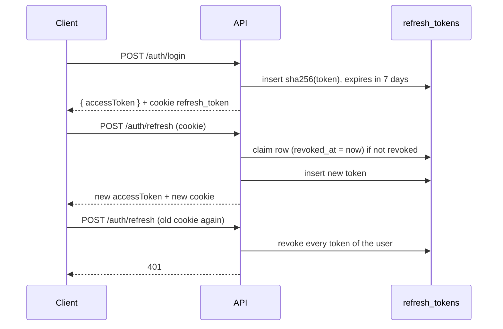

# Identity module

Accounts and sessions: students register themselves, lecturers are seeded. Login gives a
short-lived access token and a rotating refresh token in an httpOnly cookie. The module also
serves the study programs (master data) and the student search used to send invitations.

## Personas

| Persona  | Goal                                                                  |
| -------- | --------------------------------------------------------------------- |
| Student  | Create an account with their study program and cohort, then sign in.  |
| Lecturer | Sign in with a seeded account and find registered students to invite. |

## User stories

**US-01 Registration and authentication**

- A student registers with **name, NRP, email, password, study program and cohort year**.
  - Name 3–100 characters; NRP exactly 10 digits, unique; email valid, unique.
  - Password at least 8 characters with an upper-case letter, a lower-case letter and a digit.
  - Study program from `GET /study-programs`; cohort year from 2000 to the current year (WIB).
- Login returns an access token and sets the refresh-token cookie.
- The refresh token is rotated on every use; reusing an old one is refused (401).
- Logout revokes the refresh token and clears the cookie.

**Student search (part of US-03)**

- A lecturer searches students by name/NRP and filters by study program, degree and cohort.
- With `eligibleForProjectId` the list only shows students of the right degree who are not members yet.

## Business rules

| ID    | Rule                                                                                                                                                                      |
| ----- | ------------------------------------------------------------------------------------------------------------------------------------------------------------------------- |
| BR-17 | The degree (S1/S2/S3) is derived from the study program name prefix (`degreeOf`); it has no column of its own. Degree-specific project types only accept that degree.     |
| BR-18 | A student must pick a registered study program and a cohort year from 2000 to the current year. Students cannot change either afterwards (done by a developer in the DB). |

Other rules enforced here:

- Lecturers have no registration endpoint; their accounts are seeded.
- Email and NRP are unique among active accounts (checked by the service); a soft-deleted account frees them for reuse.
- A soft-deleted account cannot log in, refresh or read `/auth/me` (401).
- Login and register are rate limited to 5 requests per minute (429).

## Session flow

- Access token: JWT `{ sub, role }`, lifetime `JWT_ACCESS_TTL` (15 minutes). Sent as `Authorization: Bearer`.
- Refresh token: 32 random bytes, stored only as a SHA-256 hash, lifetime `JWT_REFRESH_TTL_DAYS` (7).
  Cookie `refresh_token`: `httpOnly`, `secure`, `sameSite=strict`, `path=/api/v1/auth`.
- **Reuse detection:** a refresh with an already revoked token revokes every session of that user.

## Access

| Endpoint              | Who                       |
| --------------------- | ------------------------- |
| `GET /study-programs` | public                    |
| `POST /auth/register` | public                    |
| `POST /auth/login`    | public                    |
| `POST /auth/refresh`  | public (needs the cookie) |
| `POST /auth/logout`   | any signed-in user        |
| `GET /auth/me`        | any signed-in user        |
| `GET /students`       | lecturer (student → 403)  |

Every endpoint not marked `@Public` needs a valid Bearer token (401). `@Roles` on the wrong role → 403.
Public endpoints ignore a broken `Authorization` header.

## Endpoints

All responses are wrapped as `{ data }` (lists: `{ data, meta }`); errors are `{ statusCode, error, message, code }`.

### GET /study-programs

- Public. Returns `{ id, name, degree }` sorted by name; `degree` comes from the name prefix.
- Filter: `degree` (`S1`/`S2`/`S3`).

### POST /auth/register

1. DTO validation (rules above); email trimmed and lower-cased, name trimmed → else 400.
2. Study program exists → else 400 `STUDY_PROGRAM_NOT_FOUND`.
3. Email or NRP used by an active account → 409 `EMAIL_TAKEN` / `NRP_TAKEN`.
4. Hash the password with argon2, insert the user with role `student`.
5. 201 with the profile (no password).

### POST /auth/login

1. Find the active account by email (case-insensitive) and verify the argon2 hash.
2. Wrong email or wrong password → the same 401 "Email atau password salah".
3. Issue tokens: 200 `{ accessToken }` + refresh cookie.

### POST /auth/refresh

1. No cookie or unknown token → 401.
2. Token already revoked → revoke all tokens of the user → 401.
3. Token expired or account deleted → 401.
4. Claim the row with a conditional update (`revoked_at IS NULL`); losing the claim (two refreshes at once) is treated as reuse → 401.
5. Issue a new pair: 200 `{ accessToken }` + new cookie.

### POST /auth/logout

Revoke the token in the cookie (if any), clear the cookie, 204. Needs an access token.

### GET /auth/me

Profile of the current user: `id, name, email, role, nrp, cohortYear, studyProgram { id, name, degree }`
(`null` fields for lecturers). Deleted account → 401 even with a valid access token.

### GET /students (lecturer)

- Active students only, sorted by name then id (stable pages); no email or password in the response.
- Filters: `q` (name or NRP, `%`/`_` matched literally), `studyProgramId`, `degree`, `cohortYear`.
- `eligibleForProjectId`: the project must be owned by the lecturer (404); adds the project's required degree
  and excludes current members.

## Data and concurrency

- Table `users`: `role` (`student`/`lecturer`), `nrp`, `cohort_year`, `study_program_id` (students only), `deleted_at`.
- Table `refresh_tokens`: `token_hash` (unique), `expires_at`, `revoked_at`.
- Table `study_programs`: `name` unique, seeded; the `S1/S2/S3 ` prefix is checked by the seeder (`degreeOf`).
- The partial unique indexes on `users.email` / `users.nrp` from the PRD are not migrated yet (see the Database section of `apps/api/README.md`).
- Rotation claims the token with `updateMany … WHERE revoked_at IS NULL`, so two concurrent refreshes
  with the same token give one 200 and one 401.

## Events

None. Identity sends no email (no password reset or email verification in scope).
