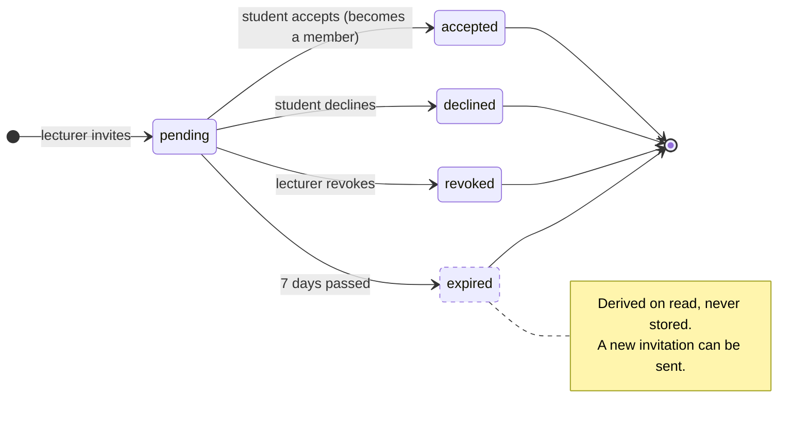

# Project module

A **project** is a supervision group owned by one lecturer. Students join only by accepting an
invitation. The project type decides the required degree and the **track mode**, which every
other module uses for privacy: on `individual` projects each student's work is private, on
`shared` projects members see everything.

## Personas

| Persona  | Goal                                                                               |
| -------- | ---------------------------------------------------------------------------------- |
| Lecturer | Create a project per supervision group, invite the right students, manage members. |
| Student  | Receive invitations, join or decline them, and see the projects they belong to.    |

## User stories

**US-02 Managing projects**

- A lecturer creates a project: title, description, type, start date, optional end date.
- Final-project types (S1/S2/S3 thesis and proposals) → `individual`; general types (research, publication,
  competition, external project) → `shared`.
- No limit on the number of students.
- List my projects (lecturer: owned; student: joined) with title search, type, degree and period filters.
- Only the owner edits or soft-deletes a project, lists and removes members.

**US-03 Invitations**

- The lecturer searches registered students (see the identity module) and invites one → email E1.
- A student of the wrong degree for the project type is refused (400 `DEGREE_MISMATCH`).
- An invitation is valid for 7 days, checked when it is read or answered.
- The student answers with one endpoint: `accept` or `decline`. The lecturer can revoke a pending one.
- No two pending invitations for the same student and project; members cannot be invited again (409).

### Project types

| Type                       | Label                | Degree | Track mode   |
| -------------------------- | -------------------- | ------ | ------------ |
| `s1_thesis_proposal`       | Proposal Tugas Akhir | S1     | `individual` |
| `s1_thesis`                | Tugas Akhir          | S1     | `individual` |
| `s2_thesis_proposal`       | Proposal Tesis       | S2     | `individual` |
| `s2_thesis`                | Tesis                | S2     | `individual` |
| `s3_dissertation_proposal` | Proposal Disertasi   | S3     | `individual` |
| `s3_dissertation`          | Disertasi            | S3     | `individual` |
| `research`                 | Riset                | any    | `shared`     |
| `publication`              | Publikasi Ilmiah     | any    | `shared`     |
| `competition`              | Lomba                | any    | `shared`     |
| `external_project`         | Project Luar         | any    | `shared`     |

The mapping lives in code (`PROJECT_TYPE_RULES`), not in a table; every project response includes `label`,
`requiredDegree` and `trackMode`.

## Business rules

| ID    | Rule                                                                                                                                                                                                                          |
| ----- | ----------------------------------------------------------------------------------------------------------------------------------------------------------------------------------------------------------------------------- |
| BR-01 | Only lecturers create projects; the creator is the owner (`projects.lecturer_id`). One lecturer per project.                                                                                                                  |
| BR-02 | Students become members only by accepting an invitation.                                                                                                                                                                      |
| BR-03 | Invitations expire 7 days after creation; a pending one past `expires_at` reads as `expired` and cannot be answered or revoked (409).                                                                                         |
| BR-04 | Degree and track mode come from the type. The type is locked when the project has members or pending invitations; a type that changes the track mode is also locked when the project has folders (409 `PROJECT_TYPE_LOCKED`). |
| BR-05 | `individual`: a student only reaches their own consultations, folders, versions, feedback, revisions and logbook. `shared`: members see all project data, but writes follow ownership (403). A former member gets 404.        |
| BR-15 | Soft delete does not cascade; every query on project data filters `projects.deleted_at IS NULL`, so the data disappears with it. Exception: active consultations are cancelled (BR-22).                                       |
| BR-17 | Degree-specific types only accept students of that degree (400 `DEGREE_MISMATCH`). General types accept any degree.                                                                                                           |
| BR-22 | Removing a member or deleting the project cancels the active consultations involved in the same transaction → E7 (see the consultation module).                                                                               |

## Invitation status flow

Every status except `pending` is final. Acting on a non-pending invitation → 409 `INVITATION_NOT_PENDING`;
on an expired one → 409 `INVITATION_EXPIRED`.

## Access

| Action                                   | Student | Lecturer |
| ---------------------------------------- | ------- | -------- |
| List projects                            | joined  | owned    |
| View project, list members               | member  | owner    |
| Create project                           | 403     | ✅       |
| Edit / delete project, remove member     | 403     | owner    |
| List / send / revoke project invitations | 403     | owner    |
| List my invitations, respond             | invitee | 403      |

Not the owner or a member (or the project is deleted) → **404** `PROJECT_NOT_FOUND`. Wrong role → **403**.

## Endpoints

All responses are wrapped as `{ data }` (lists: `{ data, meta }`); errors are `{ statusCode, error, message, code }`.

### GET /projects

- Lecturer: owned projects; student: projects they are a member of. Deleted projects never show.
- Filters: `q` (title), `type`, `degree` (types requiring that degree), `startFrom`/`startTo`;
  `sort` `createdAt` (default) / `title` / `startDate`, `order`.

### POST /projects (lecturer)

1. Validate: title 3–200, description ≤ 5000, valid type, `startDate` (`YYYY-MM-DD`), optional `endDate`.
2. `endDate` before `startDate` → 400 `INVALID_DATE_RANGE`.
3. Insert with `lecturer_id` = the caller → 201.

### GET /projects/:projectId

Visible project (404) with `summary.memberCount`; `summary.pendingInvitationCount` for the owner only (`null` for students).

### PATCH /projects/:projectId (owner)

1. Owned project (404).
2. Type changed → locked with members or live pending invitations, or when the track mode changes and the
   project has folders → 409 `PROJECT_TYPE_LOCKED`.
3. Merge dates with the stored ones; end before start → 400 `INVALID_DATE_RANGE`. `endDate: null` clears it.
4. Update → 200.

### DELETE /projects/:projectId (owner)

Transaction: **lock the lecturer row** → set `deleted_at` → cancel active consultations of the project
(`status_reason` "Project telah dihapus oleh dosen") → 204. One `consultation.cancelled` event per cancellation → **E7**.

### GET /projects/:projectId/members

Visible project. Active members sorted by name, with study program and degree. Filter: `q` (name or NRP).

### DELETE /projects/:projectId/members/:studentId (owner)

Transaction: lock the lecturer → delete the membership row (not a member → 404 `MEMBER_NOT_FOUND`) → cancel the
student's active consultations in the project ("Mahasiswa tidak lagi menjadi anggota project") → 204 → **E7**.
History (folders, versions, consultations) stays; the student loses access to it.

### GET /projects/:projectId/invitations (owner)

Invitations of the project with the derived status. Filter: `status` (`pending`, `accepted`, `declined`, `revoked`, `expired`).

### POST /projects/:projectId/invitations (owner)

1. Owned project (404); student exists and is active (404 `STUDENT_NOT_FOUND`).
2. Student degree fits the type → else 400 `DEGREE_MISMATCH`.
3. Already a member → 409 `ALREADY_MEMBER`; a live pending invitation → 409 `INVITATION_ALREADY_PENDING`.
4. Transaction: close expired pending rows of the pair (`revoked`) → insert with
   `expires_at` = now + 7 days → 201.
5. Event `invitation.created` → **E1** to the student.

### DELETE /projects/:projectId/invitations/:invitationId (owner)

Invitation of this project (404 `INVITATION_NOT_FOUND`) → must be pending and not expired (409) → `revoked` → 200.

### GET /invitations/me (student)

The student's invitations with the derived status. Filter: `status`.

### POST /invitations/:invitationId/respond (student)

1. The student's own invitation (404 `INVITATION_NOT_FOUND`); `action` is `accept` or `decline` (400).
2. Pending and not expired → else 409.
3. Transaction: conditional update on `status = pending AND expires_at > now`; on accept also insert the membership → 200.

## Emails

| Event / trigger          | Email | Recipients                                              |
| ------------------------ | ----- | ------------------------------------------------------- |
| `invitation.created`     | E1    | the invited student                                     |
| `consultation.cancelled` | E7    | consultation participants (see the consultation module) |
